I spent three years on Scroll's zk-rollup proving stack, from Halo2 circuits to the GKR recursion verifier for [Ceno](https://github.com/scroll-tech/ceno), Scroll's GKR-based RISC-V zkVM. After Scroll, I designed and built **Apogee VM**, a GKR-arithmetized RISC-V zkVM, as its sole developer.

**Open to remote work** in ZK, cryptography and protocol engineering: full-time, contract or consulting.

### Apogee VM · v1.0.0, October 2026

A RISC-V (RV32IMAC) zkVM in Rust. It proves that a guest program ran correctly and folds the proof into one Groth16 proof, which a single contract call verifies.

- **Proof system:** a pure GKR prover and verifier over 23 layered circuit families on BN254's scalar field, with LogUp lookups and offline memory checking by multiset grand product.
- **Engineering:** fully detachable precompiles (Keccak, SHA-256, Poseidon2, curve operations), a parallel two-pass streaming prover with a global memory pre-commitment, and host and guest SDKs.
- **Post-quantum v2.0.0, in active development:** a Module-SIS lattice commitment in place of KZG-based Mercury, small-field re-fielding, and guest-callable ML-DSA and FN-DSA (Falcon) signatures.

<picture>
  <source media="(prefers-color-scheme: dark)" srcset="assets/apogee-dark.svg">
  <source media="(prefers-color-scheme: light)" srcset="assets/apogee-light.svg">
  
</picture>

One end-to-end run on CPUs only: block 257,510 of an Ethereum devnet (60 transactions, 101.5 Mgas). Figures from the <a href="https://www.gweb3networks.com/reactor/apogee-vm-v1-0-0.html">v1.0.0 release notes</a>.

### Scroll · Senior Zero-Knowledge Engineer, 2023–2026

[80 merged pull requests](https://github.com/search?q=org%3Ascroll-tech+author%3Adarth-cy+is%3Apr+is%3Amerged&type=pullrequests) across three generations of Scroll's proving stack: Halo2 circuits, Spartan-based recursion, and GKR recursion on OpenVM.

- **GKR recursion for Ceno:** the recursion verifier, running as a program on OpenVM's native VM, with [binary-tree aggregation](https://github.com/scroll-tech/ceno-recursion-verifier/pull/69) to a Halo2-wrapped root.
- **Native sumcheck chip:** evaluates one GKR product or LogUp layer per row ([openvm#8](https://github.com/scroll-tech/openvm/pull/8)) and cut recursion-program cycle counts.
- **Fiat–Shamir soundness:** [tower-proof evaluations bound into the transcript](https://github.com/scroll-tech/ceno/pull/1268), a [Poseidon2 multi-observe challenger](https://github.com/scroll-tech/openvm/pull/3), and a [lookup-bus hint bridge](https://github.com/scroll-tech/openvm/pull/39) that replaced trusted loads.
- **Audited Halo2 circuits:** zkEVM circuits for mainnet EIP-4844 blobs, zstd compression and EIP-1559, carried through Trail of Bits audit cycles.

### Expositories

Long-form notes on [gweb3networks.com](https://www.gweb3networks.com/expositories.html):

- [The Geometry of the Sumcheck Protocol](https://www.gweb3networks.com/expositories/geometry-of-the-sumcheck-protocol.html)
- [Lattice-Based Polynomial Commitment Schemes](https://www.gweb3networks.com/expositories/lattice-based-polynomial-commitments.html): Greyhound, Hachi, Akita and four more
- [The Geometry of SIS](https://www.gweb3networks.com/expositories/geometry-of-the-sis-problem.html): how n, m, q and β set the cost of the best attacks
- [ZK-Friendly Signature Schemes](https://www.gweb3networks.com/expositories/zk-friendly-signature-schemes.html): Schnorr over Grumpkin, ML-DSA, FN-DSA and SLH-DSA
- [RISC-V Opcodes Under the Prover](https://www.gweb3networks.com/expositories/riscv-opcodes-under-the-prover.html)
- [Guest Program Compilation and ISA Targeting Across zkVMs](https://www.gweb3networks.com/expositories/guest-program-compilation-and-targeting.html)

Interactive walkthroughs: [Mercury PCS](https://www.gweb3networks.com/reactor/mercury-pcs-walkthrough.html) · [BN254 pairing](https://www.gweb3networks.com/reactor/bn254-pairing-derivation.html) · [Poseidon2 transcript](https://www.gweb3networks.com/reactor/poseidon2-transcript-visualizer.html) · [RV32IM instructions](https://www.gweb3networks.com/reactor/riscv-zkvm-visualizer.html)

M.S. Applied Mathematics (Operations Research), Columbia University · B.A. Economics and Mathematics, NYU · Remote from Nassau, The Bahamas (US Eastern time)
